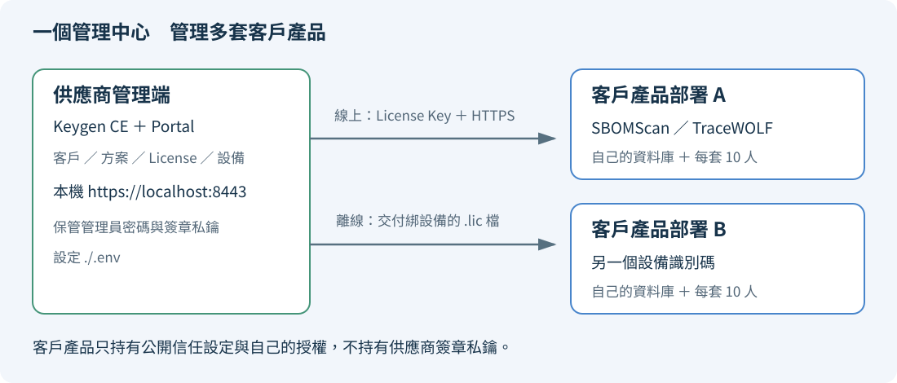
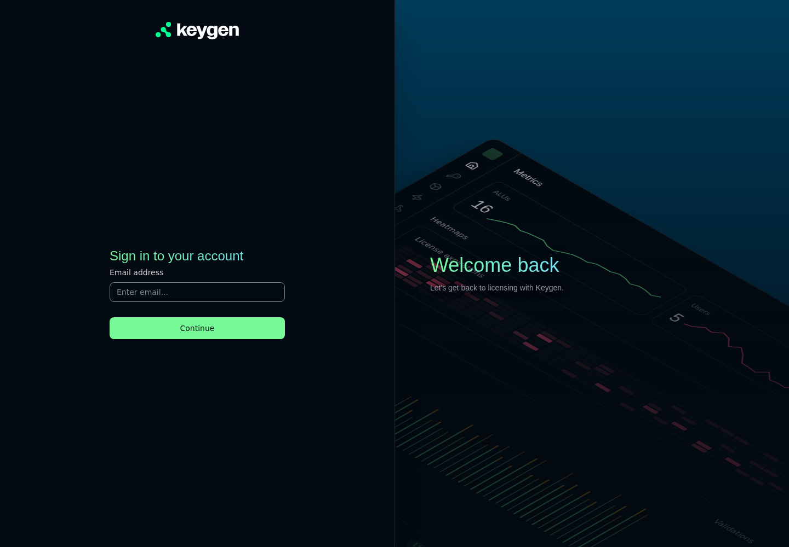
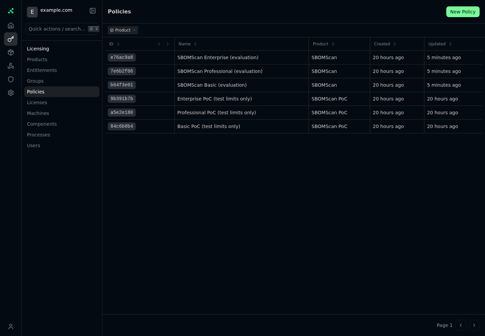
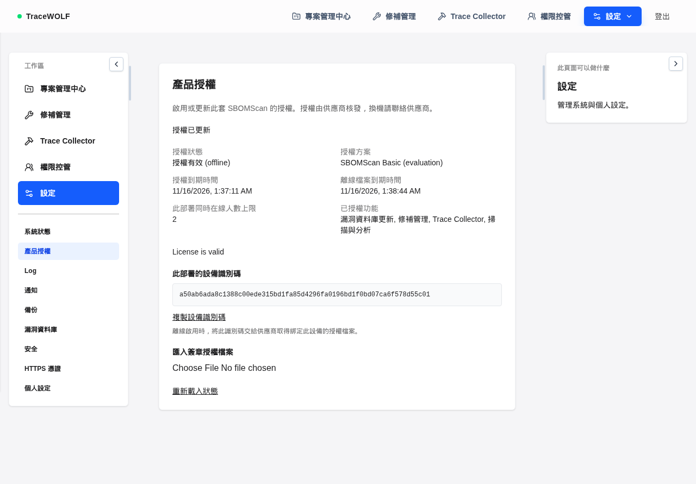
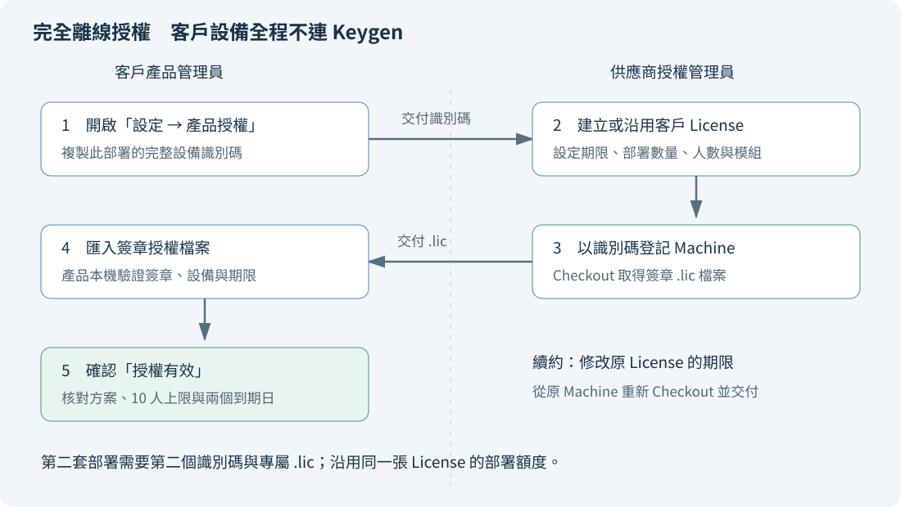
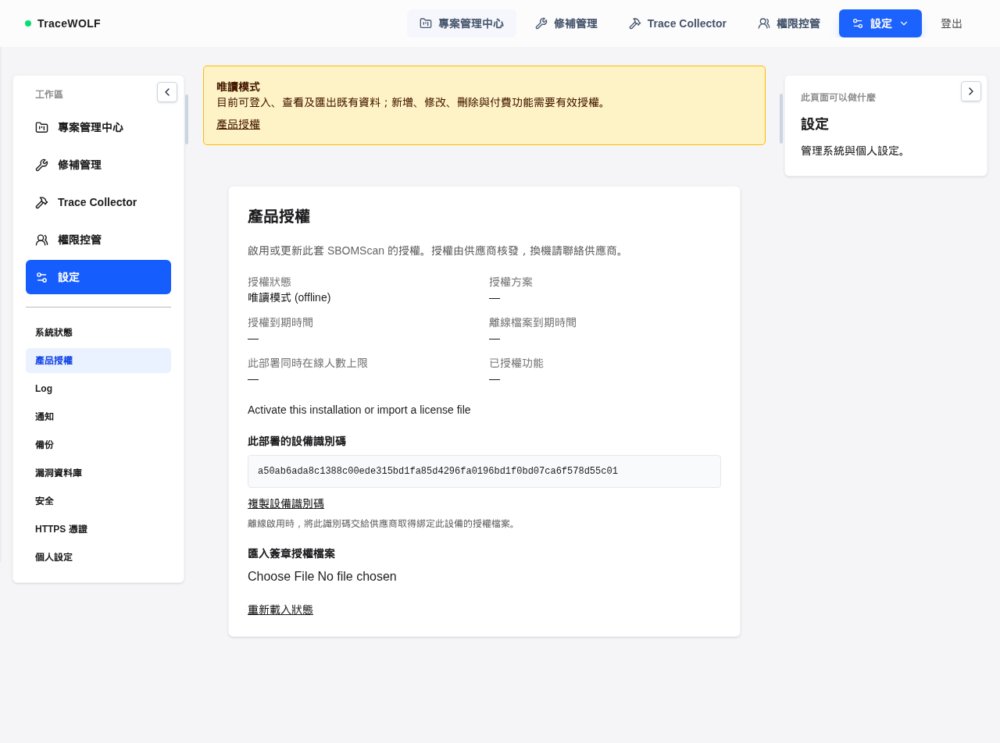
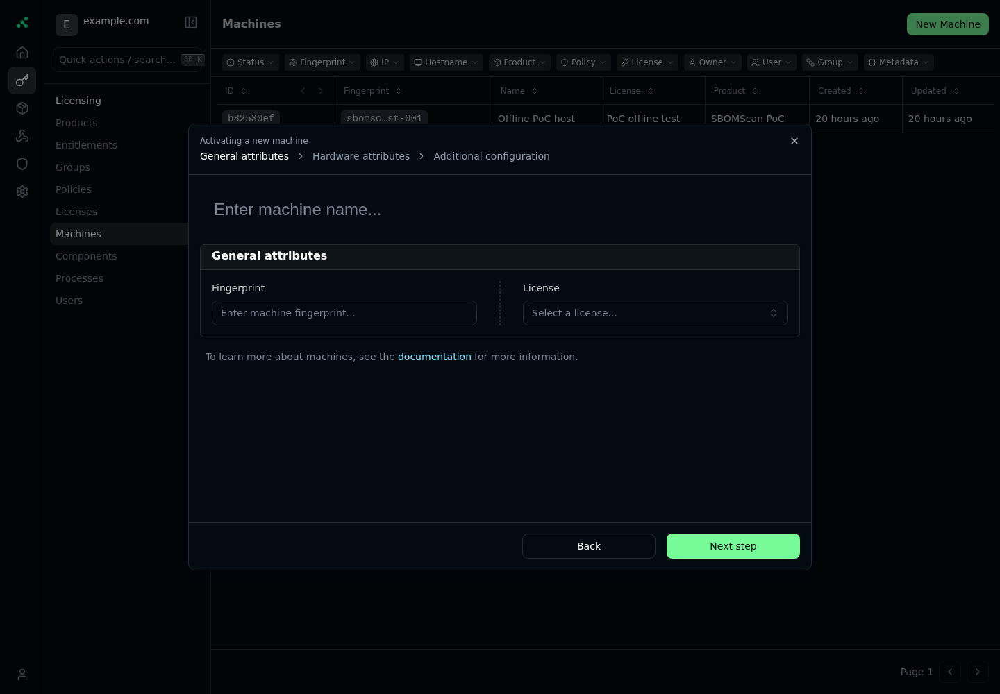

# SBOMScan 授權管理操作手冊

這份手冊教你使用目前專案的 Keygen CE 與官方 Portal，替要交付給客戶的 SBOMScan／TraceWOLF 產品核發授權。從啟動管理端，到客戶啟用、完全離線交付、續約與換機，都有對應步驟。

如果你剛完成 `product.py init` 和 `product.py issue`，可以直接從「找到已核發的 License Key」開始，再選擇「首次連線啟用」或「完全離線授權」。**已成功執行的 `issue` 不要為了查看 Key 而重跑，因為每次都會建立另一張 License。**

本手冊指令從獨立的 LicenseServer 專案根目錄執行。跨專案產品測試前，先依 [README](../README.md) 設定 `SBOMSCAN_SOURCE_DIR` 與 `LICENSE_SERVER_DIR`。產品設定檔指的是 SBOMScan 的 `.env`；供應商設定檔則是 LicenseServer 的 `.env`。

```sh
cd /absolute/path/LicenseServer
```

瀏覽器圖文版：[開啟操作手冊](操作手冊.html)。可在瀏覽器使用列印功能另存 PDF。畫面上的測試資料、設備識別碼與日期只供辨識位置，以你實際看到的內容為準。

各種模式與模組的實測結果、已修正問題與限制，見[授權功能檢查報告](授權檢查報告.md)。未填 `LICENSE_MODE` 時會預設使用 offline；正式 Docker 映像拒絕 disabled 模式。

## 操作路線

| 你現在要做的事 | 閱讀章節 |
|---|---|
| 搞清楚兩套系統的分工 | [先分清楚管理端與產品端](#先分清楚管理端與產品端) |
| 第一次啟動管理端、登入 Portal | [啟動授權管理端](#啟動授權管理端) |
| 建立授權並找出 Key | [核發客戶授權](#核發客戶授權) |
| 在同一台電腦試用連線啟用 | [首次連線啟用](#首次連線啟用) |
| 客戶環境不能連外 | [完全離線授權](#完全離線授權) |
| 改期限、改額度、暫停或換機 | [日常管理](#日常管理) |
| 遇到錯誤或唯讀模式 | [問題排除](#問題排除) |

## 先分清楚管理端與產品端



| 項目 | 供應商管理端 | 客戶產品端 |
|---|---|---|
| 使用的人 | 你或負責核發授權的人 | 客戶的系統管理員與產品使用者 |
| 系統 | Keygen CE ＋ Portal | SBOMScan／TraceWOLF |
| 本機測試網址 | `https://localhost:8443` | `https://localhost` |
| 登入帳號 | `./.env` 的管理員 | 客戶產品自己的管理員帳號 |
| 設定檔 | `./.env` | 專案根目錄 `.env` |
| 主要工作 | 建客戶、訂方案、核發與管理 License | 驗證授權、計算在線人數、執行功能與唯讀限制 |
| 資料庫 | Keygen 自己的 PostgreSQL | 客戶產品自己的 PostgreSQL |

產品頁面可能顯示 TraceWOLF 品牌，授權目錄仍叫 SBOMScan，這裡指的是同一個被授權的產品。客戶不必登入你的 Keygen Portal。

### 常見名詞

| 名詞 | 在這個專案的意思 |
|---|---|
| Product | 被販售的軟體，這裡是 `SBOMScan` |
| Policy | 方案範本，例如 `SBOMScan Basic (evaluation)` |
| License | 某位客戶買到的一份授權，包含期限與額度 |
| License Key | 客戶輸入產品畫面、用來連線啟用的授權碼 |
| Machine | 已登記的一套產品部署，占用一個部署名額 |
| Fingerprint | 產品產生的「設備識別碼」，不是自己隨意取的主機名稱 |
| Machine File | 綁定設備且有數位簽章的 `.lic` 授權檔案 |
| Entitlement | 允許使用的功能模組，例如掃描、修補管理 |
| Checkout | 從既有 Machine 取得簽章檔案，不是釋放部署名額 |

### 兩套部署和十人怎麼計算

本手冊的範例是同一客戶拿到 **Basic、2 套部署、每套同時在線 10 人**。

第一套最多 10 人，第二套也最多 10 人。第一套只用了 3 人時，第二套仍然最多 10 人，兩套之間不借用額度。建立第三個不同設備識別碼的部署，會被 Keygen 拒絕。

同一個使用者在同一套產品開多個分頁或 Session，共用一個名額。前端約每 30 秒回報活動；超過 90 秒沒有活動、登出、Session 到期或帳號停用，會釋放有效使用名額。產品在線人數與 Portal 的 Processes 清單是不同的管理機制，不需為每位產品使用者手動新增 Process。

## 啟動授權管理端

### 檢查執行環境

供應商主機需要 Linux、可使用的 Docker Engine、Python 3、Git，以及首次下載映像和 Portal 所需的網路。

```sh
docker info
python3 --version
git --version
```

`docker info` 應能列出 Server 資訊。如果顯示連不到 Docker daemon，先啟動 Docker。以下工具會在專案內準備 Compose，不要求系統已安裝 `docker compose`。

### 啟動與檢查

```sh
python3 ./poc.py up
```

第一次會下載映像、建置 Portal、建立資料庫和管理員，可能需要一段時間。完成後應出現 Portal 網址與以下檢查結果：

```text
PASS /: 200
PASS /v1/ping: 200
PASS /v1/health: 204
```

日後只想確認是否可用，執行：

```sh
python3 ./poc.py check
```

### 登入 Portal

1. 在供應商電腦開啟 `https://localhost:8443`。
2. 本機測試使用自建 CA。登入後可到 **設定 → 安全性 → 本機 HTTPS 憑證**，按 **下載本機 CA 憑證**，依頁面說明安裝至 Windows「目前使用者 → 受信任的根憑證授權單位」，再關閉所有 Chrome 視窗並重開。下載內容是目前 Caddy 使用的公開根憑證，不含私鑰；下載不會自動完成信任設定。若首次連線已被瀏覽器憑證警告阻擋，先從本機 `./.runtime/root.crt` 安裝。這個網址目前只綁定本機，其他電腦不能直接連線。
3. 在本機編輯器開啟 `./.env`，找到 `KEYGEN_ADMIN_EMAIL` 與 `KEYGEN_ADMIN_PASSWORD`。不要把整份設定檔貼到聊天或交給客戶。
4. 在同一頁輸入 Email（管理員也可填 `admin`）與密碼，按 **登入** 完成登入。初始 Email 為 `admin@example.com`，密碼是自動產生的；若帳號啟用雙重驗證，登入後會要求輸入驗證碼。



這個密碼只用於 Keygen 管理端，不是 SBOMScan 的登入密碼。PoC 沒有設定寄信服務，不能依靠忘記密碼郵件取回帳號。

### 建立產品與方案

```sh
python3 ./product.py init
```

成功後會看到：

```text
SBOMScan product: 一個產品 UUID
Public trust configuration: ./.runtime/product-public.env
```

這個命令會建立或補齊產品、三個評估方案與功能模組。可重複執行 `init`，不會每次新增另一個產品。三個方案現階段的預設功能相同，正式的 Basic／Professional／Enterprise 內容仍需由你決定。

命令也會輸出 **Portal Products** 的完整連結，開啟後應看到 `SBOMScan`。若你已在 Portal 刪除產品，工具會先保留舊目錄，再建立新產品與方案；此時 Product ID 會改變，需從最新 `product-public.env` 更新客戶產品設定，原本已刪除的 License 不會自動恢復。

### Portal 的選單怎麼看

登入後點左邊鑰匙圖示，進入 **Licensing**。如果側欄收起，先將它展開。



| 選單 | 用途 |
|---|---|
| Products | 確認產品為 `SBOMScan` |
| Policies | 找到 Basic／Professional／Enterprise 的方案範本 |
| Licenses | 查詢客戶的授權、期限與額度 |
| Machines | 查看已啟用部署，換機時釋放舊設備 |
| Entitlements | 管理功能模組代碼 |
| Users | 查看管理端使用者與以客戶信箱建立的授權持有人 |

若之前跑過 `smoke.py`，清單還會出現 `SBOMScan PoC` 及名稱含 `PoC (test limits only)` 的資料。正式產品操作請選 `SBOMScan` 與 `SBOMScan Basic (evaluation)` 等方案，避免用到另一組 PoC 測試資料。首頁 Metrics 的部分歷史分析屬於 EE；要確認 CE 是否有資料，請看各項清單。

## 核發客戶授權

### 專案額度：有限與不限

新版在「授權原則 → 編輯」及「授權 → 新增／編輯」的中繼資料區提供 **每套部署的專案額度**：填正整數，或勾選 **不限專案數**。試用 Trial 預設 3 個、Basic 預設 5 個；Professional／Enterprise 請自行設定方案預設或於核發時指定。

配發時會將方案預設複製到該張 License 的 `metadata.max_projects`；單張授權可覆蓋預設。正整數代表上限，`-1` 表示不限。日後只修改 Policy 預設值不會回溯改寫已核發的 License。命令列核發可加 `--max-projects 5` 或 `--max-projects -1`；不填時取政策預設，缺少有效預設就拒絕核發。

這個額度會隨 Machine File 簽章，SBOMScan 在後端依整套部署的專案總數執行限制，一般新增與 Collector 自動建立共用交易鎖。刪除專案可釋放名額；若降低到比既有數量少，不刪除舊資料，只禁止新增。`.env` 和瀏覽器欄位不能覆蓋額度，修改授權檔會使簽章無效。

既有 License 不會由 `init` 自動修改。升級客戶端前，請在該張 License 設好專案額度，從原 Machine 重新 Checkout 新 `.lic`。舊檔缺少額度時，既有有效授權的其他功能仍可使用，但不能建立新專案。`online` 客戶成功更新後套用，`activation` 需重新啟用／匯入，`offline` 需匯入新檔。

### 核發範例

以下由供應商在管理端執行。信箱、日期和額度請換成這次核准的商業條件：

```sh
python3 ./product.py issue \
  --customer customer@example.com \
  --plan Basic \
  --expires 2027-10-17T00:00:00Z \
  --deployments 2 \
  --concurrent-users 10
```

| 參數 | 要填什麼 |
|---|---|
| `--customer` | 客戶信箱。若已存在就沿用客戶，否則建立 |
| `--plan` | `Basic`、`Professional` 或 `Enterprise`，大小寫照填 |
| `--expires` | 未來的授權到期時間，必須包含時區 |
| `--deployments` | 這張 License 允許啟用幾套產品 |
| `--concurrent-users` | 每套部署的同時在線人數上限 |
| `--not-before` | 可選，指定開始時間；開始前無法啟用或匯入 |
| `--fingerprint` | 完全離線核發時填客戶提供的設備識別碼 |

`Z` 表示 UTC。`2027-10-17T00:00:00Z` 是台灣時間 2027 年 10 月 17 日 08:00，到該時刻就過期。如果希望有效到台灣時間 10 月 17 日結束，可填 `2027-10-18T00:00:00+08:00`。產品畫面使用瀏覽器的本地時區顯示。

成功時輸出：

```text
Issued license: 新的 License UUID
Private delivery record: /專案路徑/./.runtime/新的 License UUID.json
```

### 找到已核發的 License Key

用本機編輯器開啟上面輸出的 `.json`。其中包含：

```json
{
  "license_id": "這張授權的 UUID",
  "license_key": "交給客戶用來連線啟用的 Key",
  "customer": "customer@example.com",
  "product_id": "SBOMScan 的產品 UUID",
  "expires": "2027-10-17T00:00:00+00:00",
  "concurrent_users": 10
}
```

例如前一次核發輸出過以下紀錄：

```text
./.runtime/d6763403-e9c2-48cd-970a-99cc5c1f59ef.json
```

以你最新核發輸出的檔名為準；如果原 License 已在 Portal 刪除，留下來的舊交付紀錄不能使授權恢復。該檔只存在管理主機，不會隨 Git 或手冊分發。開啟後複製 `license_key` 的值，交給對應客戶；不要連同供應商 `.env` 或整個 `.runtime` 一起交付。終端輸出沒有顯示 Key，是正常行為。

### 從 Portal 確認核發結果

1. 進入 **Licenses**。
2. 找名稱為 `SBOMScan Basic — customer@example.com` 的項目，或用 License UUID 確認。
3. 開啟詳細頁，確認客戶 Owner、Policy、Expiry。
4. 額度應為 `maxMachines = 2`、`maxProcesses = 10`。介面可能顯示為 Max machines／Max processes。
5. 客戶尚未啟用前，Machines 為零是正常的。

`maxProcesses` 在本產品用來攜帶每部署的人數上限，同時簽入 `metadata.concurrent_users`。實際人數由 SBOMScan 的 Session 管理。若手動修改額度，兩個值要一起改；產品優先使用 metadata 的人數值。

## 準備客戶產品端

### 設定公開信任資料

供應商先開啟：

```text
./.runtime/product-public.env
```

從中取得 Account ID、Product ID 和公鑰，填到**客戶產品根目錄 `.env`**。保留原本的資料庫密碼與管理員設定；不要用這個公開檔案覆蓋整份 `.env`。

如果是全新的測試環境，且根目錄還沒有 `.env`，可先執行以下命令，再編輯密碼和授權設定：

```sh
cp -n .env.example .env
```

```dotenv
LICENSE_MODE=activation
LICENSE_ACCOUNT_ID=從 product-public.env 複製
LICENSE_PRODUCT_ID=從 product-public.env 複製
LICENSE_PUBLIC_KEY=從 product-public.env 複製的完整十六進位公鑰
LICENSE_API_URL=https://licenses.example.com
```

上方的中文與 `licenses.example.com` 都是佔位內容，要換成真實資料。`LICENSE_API_URL` 填 HTTPS 服務根網址，不要加 `/v1/accounts/...`。PoC 的本機連線方式見下一節，不能將範例網域直接拿來測試。

### 選擇授權模式

| 模式 | 填入 `.env` | 客戶怎麼啟用 | 後續要不要連線 |
|---|---|---|---|
| 持續線上驗證 | `LICENSE_MODE=online` | 輸入 License Key | 每分鐘更新，斷線寬限預設 15 分鐘 |
| 首次連線後離線 | `LICENSE_MODE=activation` | 輸入 License Key，也可匯入檔案 | 不自動更新；首次取得的檔案預設有效 30 天 |
| 全程離線 | `LICENSE_MODE=offline` | 匯入綁定設備的 `.lic` | 不呼叫 Keygen |

產品同時檢查「License 到期時間」與「檔案到期時間」，以較早者限制使用。買一年授權，不表示 `activation` 首次取得的 30 天檔案會自動用一年。到期前需再連線啟用取得新檔，或由供應商核發新的設備檔案供匯入。

`disabled` 只供從 Go 原始碼建立的開發版本使用。正式 Docker 映像在建置時關閉這個入口，設定 `LICENSE_MODE=disabled` 會使產品拒絕啟動；請改回 `offline`、`activation` 或 `online`，套用設定並更新授權。

### 套用設定

第一次建置目前含授權功能的產品，使用下一節的完整 `up -d --build` 命令。若產品映像已含此版本，只修改 `.env`，仍要重新建立 backend 容器；單純 `restart` 不會載入新的 Compose 環境變數。

一般客戶環境使用：

```sh
./.runtime/docker-compose --project-directory "$SBOMSCAN_SOURCE_DIR" -f "$SBOMSCAN_SOURCE_DIR/docker-compose.yml" up -d backend-go
```

這是供應商原始碼工作區的指令寫法。客戶若使用自己的 Compose 安裝與預先建置映像，執行交付包中的等效 `docker compose up -d backend-go`。客戶不需要安裝本目錄的管理端工具。

產品原有 HTTPS 憑證與管理員設定仍需完成。根目錄 Compose 的網站入口是 `https://localhost`，使用 `backend/certificates/tracewolf.crt` 與 `tracewolf.key`。這組產品憑證與 Keygen 的 `.runtime/root.crt` 用途不同。

## 在同一台主機另開 Docker 測試產品

這份測試設定使用已建好的 `sbomscan-backend-go:latest` 與 `sbomscan-frontend:latest`，另外啟動一套完整產品；資料庫、上傳、憑證、快取和授權狀態都使用獨立資料卷。管理端仍使用原來的 Keygen＋Portal，不需要再建一個 License Server。以下命令都在專案根目錄執行。

### 啟動與登入

先確認現有產品映像已建好、Keygen 管理端正在運行，且 `product.py init` 已產生公開設定：

```sh
./.runtime/docker-compose \
  -p sbomscan-license-test \
  --env-file ./.runtime/product-public.env \
  -f ./product-test.compose.yaml up -d --no-build
```

瀏覽器開啟 **https://localhost:9443**，這是新測試產品；原產品仍是 https://localhost，Portal 仍是 https://localhost:8443。測試站只綁定本機連接埠，首次開啟需要接受自簽憑證。全新測試資料庫的預設帳密為 `admin`／`admin123`，第一次登入依畫面要求修改密碼。若啟動時另外設定 `ADMIN_USERNAME`／`ADMIN_PASSWORD`，以該設定為準。

新站預設是 `offline`，尚未授權時進入唯讀模式。到「設定 → 授權管理」複製完整設備識別碼。

### 替這個測試部署核發授權

1. 在 Portal 開啟你要測試的 License，先確認有剩餘部署名額。
2. 新增 Machine，License 指向原授權，Fingerprint 貼上 **9443 測試站**顯示的完整設備識別碼；不能填 `a` 等任意值。
3. 從該 Machine 執行 Checkout，包含 License 和 Entitlements，使用 Ed25519、關閉加密，並設定有限期限；可選 Match TTL with Expiry。
4. 將新下載的 `.lic` 匯入 **9443 測試站**。原站使用的 `.lic` 綁定另一個部署，不能在這裡重用。
5. 確認狀態為有效、唯讀模式解除，並檢查方案、人數、模組和到期日。

若 License 顯示 2 個部署名額已用完，就不能再啟用第三套。可以另核發一張測試 License；或在確認某筆 Machine 不再使用後，由管理員釋放該名額。不要為了重試匯入而反覆新增 Machine。

同一台 Docker Host 的不同部署，因各自持有獨立的 `product_license` 資料卷，設備識別碼仍會不同。重啟或重建容器會保留識別碼；複製授權資料卷會連同部署身分一起複製，因此不應用來建立新的部署。

### 測試另外兩種模式

測試首次連線啟用時，在原啟動命令前加上模式變數：

```sh
LICENSE_MODE=activation ./.runtime/docker-compose \
  -p sbomscan-license-test \
  --env-file ./.runtime/product-public.env \
  -f ./product-test.compose.yaml up -d --no-build
```

重新整理頁面，在授權管理輸入 License Key 並按「連線啟用」。持續線上驗證則把 `activation` 改為 `online`。測試設定已連接本機 Keygen 網路並掛載驗證其 TLS 憑證所需的公開 CA。切換模式會保留已匯入的授權狀態；若要測試乾淨的首次啟用，另用新專案名稱與新連接埠建立一套。

### 停止、保留與另開一套

停止測試產品並保留資料：

```sh
./.runtime/docker-compose \
  -p sbomscan-license-test \
  --env-file ./.runtime/product-public.env \
  -f ./product-test.compose.yaml down
```

再次使用啟動命令，會沿用原資料與設備識別碼。不要加 `-v`，因為它會刪除這套產品的資料庫與授權身分。

若要同時再開另一套，將專案名稱改成 `sbomscan-license-test-2`，並在命令前加 `LICENSE_TEST_PORT=9444`，瀏覽器就改開 https://localhost:9444。每套部署的同時在線人數分別計算。

## 首次連線啟用

### 在同一台開發主機測試

1. 確認 `poc.py check` 通過。
2. 根目錄 `.env` 填妥公開信任資料，先設 `LICENSE_MODE=activation`。
3. 執行下列命令，將產品接到本機 Keygen Docker 網路，並掛載測試 CA：

```sh
./.runtime/docker-compose \
  --project-directory "$SBOMSCAN_SOURCE_DIR" -f "$SBOMSCAN_SOURCE_DIR/docker-compose.yml" \
  -f "$LICENSE_SERVER_DIR/product-local.compose.yaml" \
  up -d --build
```

這會建置完整 SBOMScan 產品及其掃描工具，首次可能下載大量工具。已經有完整產品映像、只需套用授權設定時，可改用：

```sh
./.runtime/docker-compose \
  --project-directory "$SBOMSCAN_SOURCE_DIR" -f "$SBOMSCAN_SOURCE_DIR/docker-compose.yml" \
  -f "$LICENSE_SERVER_DIR/product-local.compose.yaml" \
  up -d backend-go
```

這個 override 會將容器內連線改為 `https://keygen.localhost:8443`，並明確信任測試 CA。**容器內的 `localhost` 是容器自己**，所以不能只在根目錄 `.env` 填 `https://localhost:8443` 就期待連到供應商主機。之後管理這組本機產品時，繼續使用相同的兩個 `-f` 檔案。

### 客戶在產品畫面操作

1. 開啟 SBOMScan／TraceWOLF，登入**產品管理員**帳號。
2. 點上方 **設定**，再點左側 **產品授權**。
3. 確認模式為 `activation` 或 `online`。這兩種模式會顯示 **License Key** 欄位。
4. 貼上交付紀錄中的 Key，點 **連線啟用**。
5. 成功後應顯示 **授權已更新**、**授權有效**、方案、到期時間及人數上限。
6. 回供應商 Portal 的 **Machines**，應多出這套部署的紀錄。



這張截圖是先前測試的 `offline` 模式，因此顯示檔案匯入、上限為 2 人。你這次核發的是每套 10 人，啟用自己的 License 後應看到 10；`online`／`activation` 會額外顯示 Key 輸入欄。

### 啟用第二套部署

在另一套獨立的產品環境，用相同公開設定與同一個 License Key 啟用。第二套會產生自己的設備識別碼和 Machine，並各自計算 10 人上限。不要複製第一套已啟用的 `product_license` volume 來當第二套。

### 持續線上模式

將模式改為 `online`，套用設定後從產品頁面連線啟用。產品會定期驗證，也可由管理員點 **連線更新授權**。供應商暫停、續約或改額度後，在下一次成功更新時生效。

連線中斷時，只有先前已成功啟用且簽章仍有效的部署，才能在最近一次成功驗證後的預設 15 分鐘內繼續使用；檔案或 License 先到期就提早進入唯讀。

## 完全離線授權



### 客戶取得設備識別碼

1. 客戶產品根目錄 `.env` 設為 `LICENSE_MODE=offline`，並填入正確的三項公開信任資料。
2. 套用設定並啟動產品。尚未授權時先進入唯讀，仍可登入產品管理員帳號。
3. 開啟 **設定 → 產品授權**。
4. 按 **複製設備識別碼**，將完整內容交給供應商。



識別碼由 Host 的 machine-id 加上持久化 installation ID 產生。不要自行填 MAC 位址、Docker Container ID 或截圖中的測試識別碼。若瀏覽器無法自動複製，就選取欄位中的完整文字手動複製。

### 供應商核發第一套設備的授權檔案

以下適用於**尚未建立 License 的新客戶授權**。把 `客戶提供的完整設備識別碼` 換成收到的值：

```sh
python3 ./product.py issue \
  --customer offline-customer@example.com \
  --plan Basic \
  --expires 2027-10-17T00:00:00Z \
  --deployments 2 \
  --concurrent-users 10 \
  --fingerprint '客戶提供的完整設備識別碼'
```

成功後會額外輸出：

```text
Customer machine file: /專案路徑/./.runtime/License UUID.lic
```

交付這個 `.lic` 給該設備的管理員。這條命令會建立一張新 License 並登記第一台 Machine；如果客戶已經有 License，請用下一段將設備加到原本的 License，避免重複核發。

### 既有 License 新增離線設備

例如你這次已經有 2 套部署額度的 License，要替第一套或第二套離線設備產生檔案：

1. Portal → **Licenses**，開啟原本的客戶授權，複製完整 License ID。
2. Portal → **Machines** → **New Machine**，指定原本那張 License。
3. Fingerprint 填客戶產品顯示的完整設備識別碼；Name 可填方便辨認的名稱，例如 `客戶甲 正式環境`。
4. 建立後打開這筆 Machine 的詳細頁，從操作選單選 **Checkout**。
5. Relationships 選 **License** 和 **Entitlements**；可加選 **Policy** 讓畫面顯示方案名稱。這些選項對應 `license`、`license.entitlements`、`license.policy`。
6. 檔案期限選到 License expiry，或輸入你希望客戶下次換檔前可使用的有限期間。不要選無期限。
7. 簽章演算法選 **Ed25519**，關閉加密，輸出格式須為 `base64+ed25519`。
8. 確認後按 **Checkout machine**，在結果視窗按 **Download file** 保存 `.lic`。



Portal 的表單採分頁精靈，填好必要欄位後依序前進，未使用的額外硬體欄位可以留空，最後按 **Activate** 建立設備。Checkout 的期限選項 **Match TTL with Expiry** 表示對齊 License 到期日；**Default** 是預設 30 天。

要在 **Machine** 詳細頁操作，不要使用 License 頁面的 Checkout 代替。產品接受的是有設備綁定的 `MACHINE FILE`；只核發 `LICENSE FILE` 無法匯入。每套設備有自己的檔案，不能把同一份 `.lic` 給兩台使用。

若 Machines 已有相同 Fingerprint，直接開啟既有 Machine 重新 Checkout，不要重建設備；若兩個部署名額都被其他設備占用，先確認是否應走人工換機。

### 客戶匯入與確認

1. 客戶收到 `.lic` 後，登入產品管理員帳號。
2. 開啟 **設定 → 產品授權**。
3. 在 **匯入簽章授權檔案** 選取收到的檔案，選檔後會自動送出，不需要另按儲存。
4. 確認顯示 **授權已更新**、**授權有效 (offline)**。
5. 確認方案、人數上限、已授權功能、License 與檔案的兩個到期時間。

匯入後產品完全在本機驗證，不需要連到 Keygen。License 檔與狀態保存在產品的 `product_license` volume，重啟容器後仍保留。

## 日常管理

### 續約與重新交付檔案

1. Portal → **Licenses** → 原本的 License → **Edit**。
2. 將 Expiry 改為新核准的明確到期時間並儲存。需要指定日期時直接編輯 Expiry，避免將 **Renew** 的相對延長誤當成指定日期。
3. `online` 客戶由產品管理員按 **連線更新授權**，或等待自動更新。
4. `activation` 客戶可再次輸入原 Key 按 **連線啟用**，取得新檔；若要用匯入方式更新，從原 Machine Checkout 後交付。
5. `offline` 客戶要從原 Machine 重新 Checkout，再將新 `.lic` 交給客戶匯入。

只修改 Portal 的日期，客戶手上的舊離線檔案不會跟著改。也不需要再次執行 `issue` 或建立另一個客戶。

### 調整部署與人數額度

在原本的 License 編輯頁調整以下欄位：

| 要改的條件 | 對應欄位 |
|---|---|
| 最多部署幾套 | `maxMachines` |
| 每套最多幾人 | `maxProcesses`，以及 metadata 的 `concurrent_users`／`concurrentUsers` |
| 方案顯示名稱 | metadata 的 `plan`，以及必要時調整 Policy |
| 開始時間 | metadata 的 `not_before`／`notBefore`，含時區 |

Keygen 可能在介面或回應中把 metadata 轉為 camelCase。修改既有對應欄位，不要建立內容不同的兩份人數或開始日。產品會拒絕互相衝突的值。

調整後，依上一段的模式重新連線更新或交付新檔。若降低部署數量，先檢查既有 Machines 並處理超額設備。

### 規劃功能模組

| 功能代碼 | 產品功能 |
|---|---|
| `SBOMSCAN_SCAN` | 上傳、掃描、排程、自動掃描與重新掃描 |
| `SBOMSCAN_COLLECTOR` | Trace Collector 建置、下載與匯入入口 |
| `SBOMSCAN_REMEDIATION` | 修補紀錄與附件寫入 |
| `SBOMSCAN_VULNDB_UPDATE` | 漏洞資料庫更新、匯入與更新排程 |

在 Portal 的 **Policies** 開啟方案，查看／調整所連結的 Entitlements。調整 Policy 會影響使用此 Policy 的授權。單一客戶要增加功能時，可在該 License 加上 Entitlements；從 Policy 繼承的功能不會因為移除 License 的直接關聯而消失，要減少繼承功能需改用適當的 Policy，並確認最終有效清單。已有的離線檔案仍保留核發當時的功能，要重新 Checkout 才會帶入更新。

現階段三個評估方案都預先附上所有功能，不代表 Basic 正式應包含所有功能。後續執行 `init`／`issue` 會保留已完成初始化方案的功能編輯，不會自動補回你移除的模組。

### 保留多部署與離線所需的 Policy 設定

| 設定 | 本專案使用值 | 用意 |
|---|---|---|
| Floating | `true` | 允許一張 License 設定多個 Machine |
| Require heartbeat | `false` | 離線設備不必定時向 Keygen 回報 |
| Require check-in | `false` | 離線設備不必定時回管理端報到 |
| Authentication strategy | `MIXED` | 產品可用客戶自己的 License Key 呼叫 API |
| Scheme | `ED25519_SIGN` | 簽發產品支援的簽章檔案 |

這裡 Floating 是 Keygen 允許多設備啟用的設定，不代表在線人數共用一個中央池。產品使用者的活動回報與這裡的 Machine heartbeat 分開處理。

### 暫停與恢復授權

1. Portal → **Licenses** → 選擇客戶 License。
2. 操作選單選 **Suspend** 可暫停，選 **Reinstate** 可恢復。
3. `online` 模式在下一次成功驗證時反映狀態；完全離線或已斷線的部署無法即時收到中央變更。

`activation`／`offline` 客戶的既有簽章檔案可持續使用到原本的期限。若商業條件要求更短的撤銷延遲，需核發較短檔案期限並定期換檔，或採持續線上模式。

### 人工換機

1. 記下原 License ID、舊 Machine 與設備用途。
2. 客戶在新設備啟動產品並提供新的 Fingerprint。
3. Portal → **Machines**，確認選到舊設備後，以 **Delete** 移除其 Machine，釋放部署名額。
4. 線上／首次連線客戶在新設備輸入原 Key 啟用。
5. 完全離線客戶將新 Fingerprint 加到原 License，Checkout 後交付新 `.lic`。

刪除舊 Machine 只會釋放中央的部署登記；不能讓完全離線的舊簽章檔立即失效。人工換機時需同時記錄舊檔的最晚有效時間。

### 授權到期後的唯讀模式

| 操作 | 到期後 |
|---|---|
| 登入、查看既有資料 | 可以 |
| 匯出既有資料，包括 PDF | 可以 |
| 新增、修改、刪除資料 | 禁止 |
| 掃描、Collector、修補寫入、漏洞資料庫更新 | 禁止 |
| 更新或匯入授權 | 管理員仍可操作 |

專案管理中心的「新增專案」與 ZIP 匯入入口在唯讀時會停用，並提示唯讀模式；拖放檔案也不會建立專案。若填寫建立表單期間授權到期，送出時會顯示唯讀說明。既有專案仍可開啟查看。

取得新授權並更新成功後，可恢復有效授權所允許的操作，不需要刪除既有業務資料。

## 停止服務與保存資料

供應商管理端的常用命令：

```sh
python3 ./poc.py status
python3 ./poc.py logs
python3 ./poc.py down
python3 ./poc.py up
```

`down` 停止並移除管理端容器與網路，保留資料 volumes。下一次 `up` 使用原本帳號與授權。管理端停止後，已持有有效檔案的 `activation`／`offline` 產品不受連線影響；`online` 模式則受寬限期限制。

| 要保存的資料 | 原因 |
|---|---|
| 管理端 `./.env` | 包含資料庫密碼、帳號與加密金鑰，必須與資料庫配套保存 |
| 管理端 PostgreSQL volume | 客戶、License、Policy、Machine 與相關金鑰資料 |
| 管理端 Caddy volume | 本機 CA 資料，重建 CA 後客戶信任設定也要處理 |
| `.runtime/product-catalog.json` | 工具對應的產品、方案與模組 ID |
| `.runtime/各 License UUID.json` | 各張授權的私有交付紀錄 |
| 客戶產品 PostgreSQL 與原有業務 volumes | 使用者、專案及既有資料 |
| 客戶產品 `product_license` volume | 安裝識別碼、簽章檔案與驗證狀態 |

保留容器或執行 `down` 並不等於完成備份；正式環境需另外安排一致的資料庫備份與還原演練。不要刪除原管理端 `.env` 後沿用舊資料庫，也不要為了處理啟用問題執行 `down -v` 清空 volumes。

## 問題排除

### 建置卡在 go mod download 或 npm ci

若錯誤包含 `lookup proxy.golang.org ... i/o timeout`，或 npm 套件網址查詢逾時，先確認主機本身可以連網。目前標準 Compose 與本機 Keygen override 都預設以 Host 網路建置。若舊的根目錄 `.env` 仍指定 `DOCKER_BUILD_NETWORK=default`，改成 `host`；也可用以下指令強制指定：

```sh
DOCKER_BUILD_NETWORK=host ./.runtime/docker-compose \
  --project-directory "$SBOMSCAN_SOURCE_DIR" -f "$SBOMSCAN_SOURCE_DIR/docker-compose.yml" up -d --build
```

本機 Keygen 連線測試則使用原本的兩份設定檔，更新後已包含此建置修正：

```sh
./.runtime/docker-compose \
  --project-directory "$SBOMSCAN_SOURCE_DIR" -f "$SBOMSCAN_SOURCE_DIR/docker-compose.yml" \
  -f "$LICENSE_SERVER_DIR/product-local.compose.yaml" \
  up -d --build
```

這項設定只調整建置期間下載套件的網路；產品執行時仍使用原本的 Compose 網路。這類 DNS 錯誤不需要刪除資料庫或授權 volumes。

### init 成功但 Products 沒有資料

開啟命令輸出的 **Portal Products** 連結，重新整理頁面，確認清單有 `SBOMScan`。更新後的 `init` 會查詢 Keygen 實際資料，修正本機目錄仍記著已刪除產品的情況；執行新版 `product.py init` 即可，不需刪除整個 `.runtime` 或資料庫。

若修復時顯示重新建立產品，將最新公開設定交付給產品端；舊授權是否仍存在，需在 Portal 的 Licenses 清單確認，不能僅根據本機 `.json` 判斷。

### 無法連線或 Connection reset by peer

在供應商主機依序執行：

```sh
python3 ./poc.py check
python3 ./poc.py status
```

若 HTTPS 檢查失敗，可重建這組管理端的容器與網路，資料 volumes 保留：

```sh
python3 ./poc.py restart
python3 ./poc.py check
```

確認服務恢復後再重試失敗的命令。如果原本的 `issue` 已輸出成功，先查看交付紀錄與 Portal，避免不確定時連續核發多張。需要日誌時用 `poc.py logs`；`.runtime/setup.log` 含敏感資訊，只在本機查看。

### MAX_MACHINES_INVALID

完整訊息若包含 `must be equal to 1 for non-floating policy`，表示方案仍設為單機。先執行更新後的：

```sh
python3 ./product.py init
```

工具會對原始、未定案的評估方案做一次修正。若你之後自行調整過方案，請在 Portal 確認該 Policy 的 Floating 是 `true`，並保留前面的離線設定。修正後才重試原本失敗的核發命令。

### MACHINE_LIMIT_EXCEEDED

代表部署名額已用完。在 Portal 查看該 License 的 Machines；確認是不是舊設備未移除，或客戶真的需要增加部署數量。一般容器重啟不應產生新設備；若每次都新增，檢查 Host machine-id 掛載與 `product_license` 是否持久保存。

### 看不到 License Key 或匯入按鈕

| 產品模式 | Key 輸入 | 檔案匯入 | 連線更新 |
|---|---|---|---|
| `online` | 有 | 無 | 有 |
| `activation` | 有 | 有 | 重新輸入原 Key 啟用 |
| `offline` | 無 | 有 | 無 |

上述操作需產品管理員權限。模式不對時，修改根目錄 `.env` 並重新建立 backend 容器，不是只重新整理瀏覽器。

### 檔案匯入失敗

| 訊息或現象 | 檢查方式 |
|---|---|
| `expected a Keygen MACHINE FILE` | 檔案第一行應為 `-----BEGIN MACHINE FILE-----`，確認從 Machine Checkout |
| `unsupported license signature algorithm` | 用 Ed25519、關閉加密，輸出 `base64+ed25519` |
| `invalid license signature` | 確認檔案未修改，且產品的公開金鑰與核發端一致 |
| `license belongs to another device` | 比對客戶當前 Fingerprint，換機需重新核發 |
| `another vendor or product` | Account ID、Product ID 填錯，或用了另一組 PoC 授權 |
| `license is not valid yet` | 尚未到開始時間，或主機時間錯誤 |
| `offline license file has expired` | 檔案先到期，需重新 Checkout 並交付 |
| `license has expired` | 原 License 到期，先續約再更新檔案 |

### 有效授權仍然不能操作

先到 **產品授權** 檢查「已授權功能」，確認包含該功能的代碼。若看到人數上限訊息，請關閉不用的使用者工作階段或登出，等待活動名額釋放。每套部署分別計算，不會因另一套空著就自動增加名額。

### Vendor account and product IDs have not been configured

表示產品容器沒有收到供應商的公開 Account ID／Product ID。只執行管理端 `product.py init` 會產生公開設定檔，不會替客戶的產品環境自動套用設定。

從管理端 `./.runtime/product-public.env` 複製 `LICENSE_ACCOUNT_ID`、`LICENSE_PRODUCT_ID`、`LICENSE_PUBLIC_KEY` 到產品根目錄 `.env`，保留原本的其他設定，再依本機／客戶環境使用對應 Compose 命令重新建立 `backend-go`。不要將管理端 `./.env` 複製到根目錄。

完成公開設定後，還需要在產品「設定 → 產品授權」啟用 Key 或匯入有效 `.lic` 才能新增資料。新版介面會將缺少設定顯示為中文說明。

### 本機可測試，外部客戶連不上

目前 Keygen PoC 只開在 `127.0.0.1:8443`，正式線上交付前需設定可從客戶環境連線的管理端 HTTPS 網域、可信憑證與對外網路。將外部客戶的 API URL 填成 `localhost` 或 `keygen.localhost`，都不會指向供應商服務。

完全離線交付可先用目前的本機管理端核發檔案；客戶只需公開信任設定與自己的 `.lic`。客戶交付包不包含供應商 `.env`、`.runtime`、管理員 Token、資料庫備份或簽章私鑰。

## 一次完整操作的完成標準

完成「2 套部署、每套 10 人」的試用時，依序確認：

1. `poc.py check` 三項通過，Portal 能登入。
2. Products 有 `SBOMScan`，Policies 有三個評估方案。
3. 客戶 License 是正確信箱、期限、`maxMachines=2`、人數 10。
4. 客戶產品顯示授權有效、每部署上限 10，並列出預期功能。
5. 第二套獨立部署可啟用，第三套超過名額被拒絕。
6. `activation`／`offline` 在有效檔案期限內無需持續連線；續約後有重新更新檔案。
7. 產品重啟後設備識別碼與授權仍保留。

若要保留紀錄，截取產品授權頁與 Portal 的 License／Machine 資訊即可。交付或分享截圖前，先確認沒有顯示 License Key 或管理端密碼。
